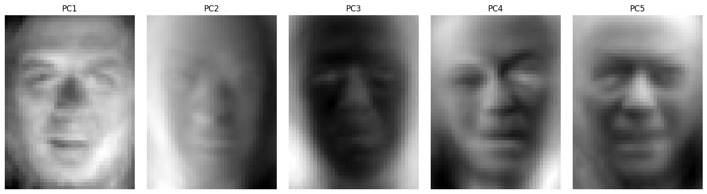
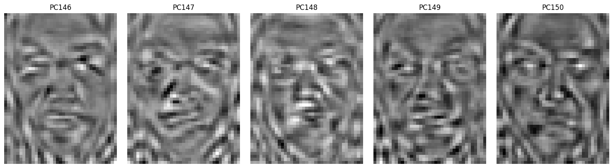

# Face Recognition with PCA + SVM

Classifying faces of 7 public figures from the **Labeled Faces in the Wild (LFW)** dataset by compressing images with **PCA** and training an **SVM** classifier inside a scikit-learn pipeline.

**Result:** accuracy improved from a **41.2%** majority-class baseline to **76.7%** with a class-balanced PCA + SVC pipeline tuned with GridSearchCV (3-fold cross-validation).

## Dataset
- 1,288 grayscale images, 50 × 37 pixels → 1,850 features per image
- 7 classes (people with at least 70 photos), strongly imbalanced (largest class 41%, smallest ~5.5%)

## Approach
1. **Compression with PCA** – projected each image from 1,850 pixels onto 150 principal components (~12× fewer features) and reconstructed images with `inverse_transform` to check the information loss.
2. **Eigenfaces** – visualised the mean face and the highest- and lowest-variance components to see what PCA keeps and what it discards as noise.
3. **Choosing the number of components** – 36 components already explain 80% of the variance; the best value for classification (grid search over 50 / 100 / 200 / 300) was **100**.
4. **Speed vs. accuracy** – compared KNN on raw pixels vs. PCA features: similar accuracy (~50%), but prediction was ~40× faster on the PCA features.
5. **Full ML pipeline** – tested scaling, class balancing and hyperparameter tuning step by step.

### Eigenfaces
The first principal components capture the overall face shape and lighting:

The last components mostly contain pixel-level noise, which PCA discards:

## Results (3-fold CV accuracy)

| Model | Accuracy |
|---|---|
| Baseline (most frequent class) | 41.15% |
| PCA (100) + SVC | 64.60% |
| StandardScaler + PCA + SVC | 68.40% |
| PCA + SVC (`class_weight='balanced'`) | 67.08% |
| **PCA + balanced SVC, tuned with GridSearchCV** (kernel, C, gamma) | **76.71%** |

## Tech
Python · scikit-learn (PCA, SVC, KNN, Pipeline, GridSearchCV, StandardScaler) · NumPy · pandas · Matplotlib

## Files
- `face_recognition.ipynb` – main analysis
- `warmup_pca.ipynb` – PCA warm-up exercise
- `tests/` – automated checks

Built during the Workintech Data Science & Machine Learning program.
